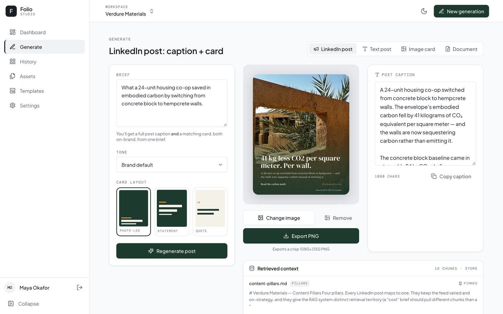
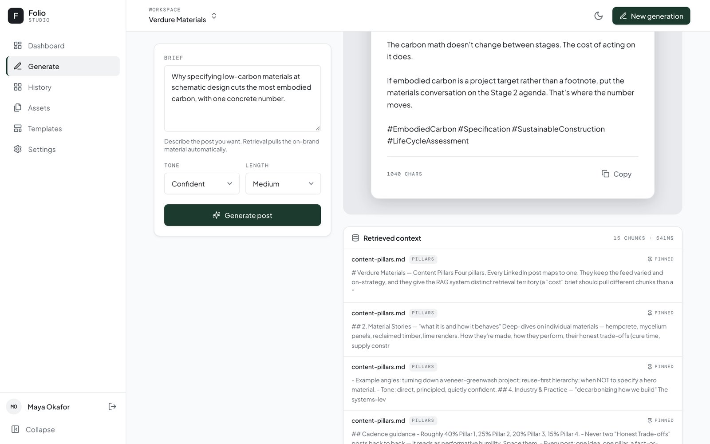
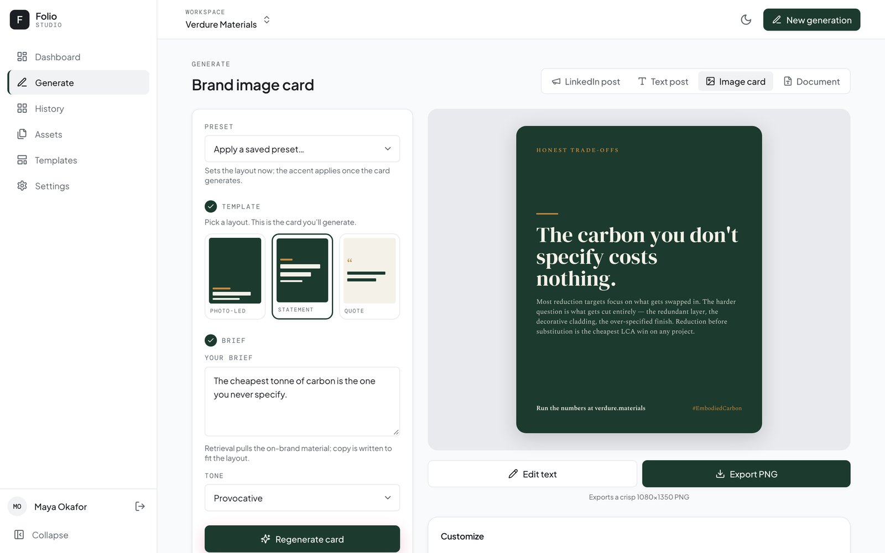
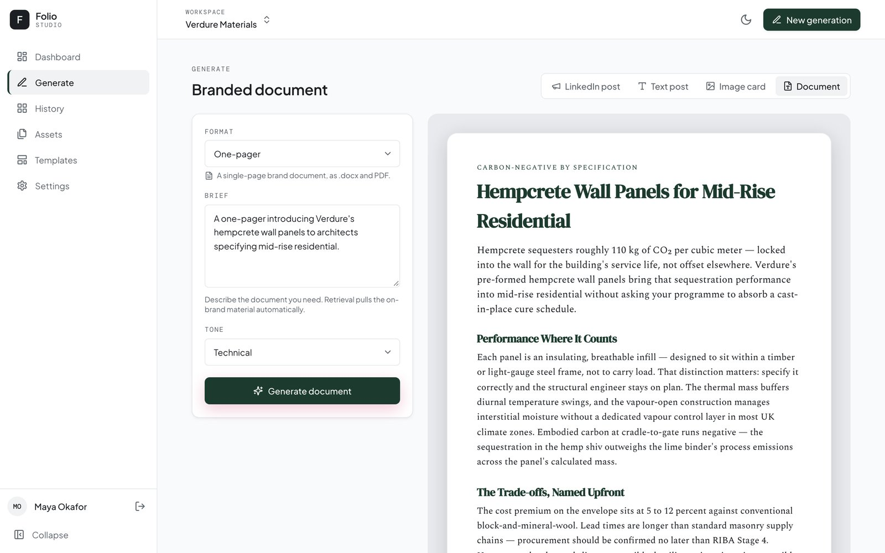
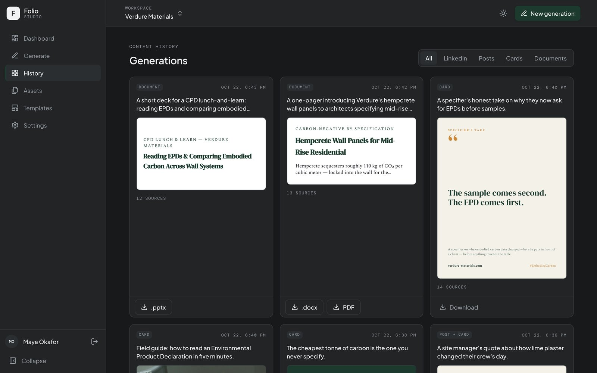
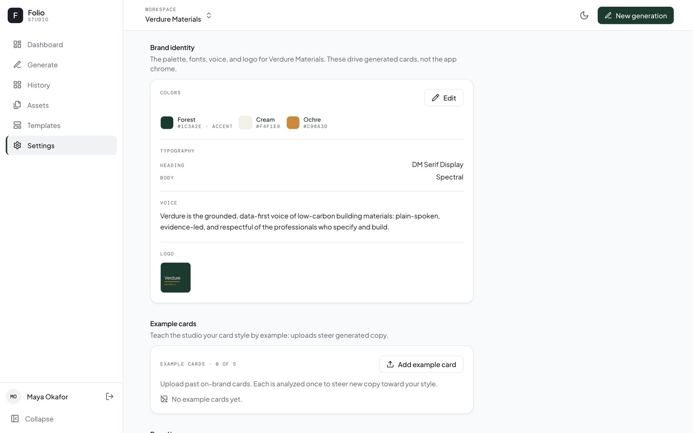

# Brand Content Studio

A **RAG-powered** brand content studio. It ingests a brand's own material (voice and tone guides, past
LinkedIn posts, content pillars, personas, competitor notes), embeds and indexes it per workspace, and then
**retrieves the relevant brand context at generation time**, so Claude writes content that sounds like the
brand instead of like a generic model.

From one brief it produces:

- **LinkedIn posts:** a ready-to-paste caption plus a matching designed card.
- **Text posts** in a chosen tone and length.
- **Image cards:** 1080 × 1350 PNGs in three layouts (photo-led, statement, quote), in the brand's colors and
  fonts, with Unsplash or your own photos.
- **Documents:** a branded one-pager (.docx and PDF) or a short slide deck (.pptx).
- **Filled templates:** upload your own branded .docx or .pptx with `{{placeholders}}` and fill it by hand, from
  a brief, or from another document.

Retrieval is the differentiator: generic generation is prompt → response, while on-brand generation needs the
brand corpus pulled in at query time. Every generation shows exactly which brand chunks it used.

> **Status:** all six build phases (text posts through robustness and limits) are merged into `dev`, the
> integration branch, along with a security audit and an October QA pass. `main` still holds the Phase 0
> scaffold; the first release and the AWS deployment are still to come. See [`CHANGELOG.md`](./CHANGELOG.md) and
> [`docs/PLAN.md`](./docs/PLAN.md).

## Screenshots

| | |
|---|---|
|  |  |
| **LinkedIn post:** caption plus a matching card from one brief | **Retrieved context:** the brand chunks behind each generation, with scores |
|  |  |
| **Image card:** brand layouts, then customize, edit text, and export | **Document:** a branded one-pager, downloadable as .docx and PDF |
|  |  |
| **History** (dark mode): every generation, re-downloadable | **Brand identity:** palette, fonts, voice, and logo |

Screenshots use the "Verdure Materials" demo brand and a made-up user.

## Features

- **Generate** in four modes (LinkedIn post, text post, image card, document). Output streams in live over SSE,
  and a **Retrieved context** panel lists the brand chunks used.
- **Card customization** without another model call: swap the layout, change the accent color, edit the text on
  the card, change the picture, or apply a saved card preset.
- **Image picker:** Unsplash search (with the required attribution), the workspace's brand image library, or
  your own upload.
- **History** of every generation, filterable by type, with re-download and a "Customize" path back into
  Generate.
- **Asset Manager:** upload PDF, Markdown, or text files by kind (voice, past posts, pillars, personas,
  competitors, other) and watch each one ingest.
- **Templates:** bring your own branded .docx or .pptx and fill its placeholders by hand, with "Draft with AI",
  or from an uploaded document. The output keeps the template's own styling.
- **Brand setup in Settings:** palette, fonts (curated list or your own .ttf uploads), voice summary, logo,
  "Learn from an image" (Claude proposes a palette, fonts, and voice from an uploaded card or guideline page),
  example cards that steer the copy style, brand images, and card presets.
- **Workspaces:** one per brand, with a switcher in the top bar.
- **Light and dark themes**, plus an optional tint that dresses the app in the active brand's color.
- **Demo mode:** "Explore as demo" signs into a seeded, read-only Verdure workspace with a daily AI limit.
- Desktop-first: the minimum supported width is 1024 px; below that the sidebar collapses to icons.

## Stack

- **Frontend:** React 19 + Vite 8 + TypeScript, Tailwind CSS 4 + shadcn/ui (Radix), Zustand, TanStack Query,
  react-hook-form + zod, lucide-react. Cards are rendered in the browser with Satori and resvg-wasm.
- **Backend:** Python 3.12, FastAPI + Motor (async MongoDB) + Pydantic v2, slowapi rate limiting.
- **AI:** Claude `claude-sonnet-4-6` (`AsyncAnthropic`, streamed over SSE) for generation, brand extraction from
  images, and template drafting; OpenAI `text-embedding-3-small` for embeddings.
- **RAG:** hand-rolled ingestion (standalone `langchain-text-splitters` for chunking, no full framework) and a
  vector store behind a swappable interface: **Chroma** today. A Qdrant store for production is planned but not
  implemented yet.
- **Documents:** python-docx, python-pptx, and reportlab; docxtpl for template filling.
- **Images:** Unsplash API (server-proxied, mandatory attribution) plus uploads.
- **Auth:** JWT (PyJWT) with a seeded demo user and an "Explore as demo" sign-in. There is no public sign-up.

Local development is fully decoupled from the cloud; the AWS deployment is deferred. See
[`docs/DECISIONS.md`](./docs/DECISIONS.md).

## Monorepo layout

```
client/      React + Vite SPA
server/      FastAPI + RAG pipeline (app/rag, app/services, app/routes, app/prompts) and the demo seed (seed/)
docs/        Planning and reference docs, the demo corpus, design system, mocks, and screenshots
Dockerfile   Production image: builds the client and serves it from the API on port 8000
```

## Local development

**Prerequisites:** Node 24 (see `.nvmrc`), Python 3.12, and Docker.

```bash
# 1. Databases: MongoDB on 127.0.0.1:27017 and Chroma on 127.0.0.1:8001 (loopback only)
docker compose up -d

# 2. Server: virtual environment, dependencies, and settings
cd server
python3.12 -m venv .venv
.venv/bin/pip install -r requirements-dev.txt   # includes requirements.txt
cp .env.example .env                            # then fill in the keys (see below)
cd ..

# 3. Client and root tooling (two separate installs)
npm install
(cd client && npm install)

# 4. Seed the demo user and the Verdure Materials workspace (safe to re-run)
npm run seed

# 5. Run the client (http://localhost:5173) and the API (http://localhost:8000)
npm run dev
```

Open http://localhost:5173 and choose **Explore as demo**. The seed ingests the Verdure corpus, so generation
works right away. The API's interactive docs are at http://localhost:8000/docs in development.

**Settings in `server/.env`** (every key is listed in `server/.env.example`):

| Key | Needed for |
|---|---|
| `ANTHROPIC_API_KEY` | All generation, brand extraction, and template drafting |
| `OPENAI_API_KEY` | Embeddings: ingesting assets (including the seed) and retrieval at generation time |
| `UNSPLASH_ACCESS_KEY` | Optional. Without it, image search shows an error; uploads still work |
| `JWT_SECRET_KEY` | Token signing. In production it must be at least 32 characters and not the default |

Keep `VECTOR_STORE_BACKEND=chroma` and `STORAGE_BACKEND=local`; the Qdrant and S3 options aren't implemented yet.

**Your own account:** there's no sign-up screen. The demo account is read-only for workspace and brand changes, so
to try uploads and the brand editor, add a user directly in MongoDB (see the seed script for the user shape).

## Quality checks

From the repo root:

```bash
npm run lint        # eslint + ruff
npm run typecheck   # tsc + mypy
npm test            # vitest + pytest (integration tests run when Mongo and Chroma are up)
npm run build       # client production build
npm run ci          # all of the above
```

`cd client && npm run format` checks formatting with Prettier. CI (`.github/workflows/ci.yml`) also builds and
boots the Docker image and runs dependency audits.

## Production image

`docker build .` produces one image that serves the built client and the API on port 8000 (non-root, with a
health check on `/api/health`). It needs external MongoDB and Chroma plus production settings
(`ENVIRONMENT=production` and a strong `JWT_SECRET_KEY`). Rate limiting is in-memory and per instance.

## Documentation

| Doc | What it covers |
|---|---|
| [`docs/PLAN.md`](./docs/PLAN.md) | **Start here:** phased build roadmap with acceptance criteria |
| [`CHANGELOG.md`](./CHANGELOG.md) | What's shipped, by phase |
| [`docs/WORKFLOW.md`](./docs/WORKFLOW.md) | How we build: vertical slices, front/back ordering, branching, commits |
| [`docs/DECISIONS.md`](./docs/DECISIONS.md) | Single source of truth for architecture decisions |
| [`docs/ARCHITECTURE.md`](./docs/ARCHITECTURE.md) | Stack, repo structure, RAG pipeline, API surface, security, gotchas |
| [`docs/DATA_MODEL.md`](./docs/DATA_MODEL.md) | MongoDB collections and the vector-store schema |
| [`docs/DESIGN.md`](./docs/DESIGN.md) | "Folio" design system (tokens, type, components) |
| [`docs/demo-corpus/`](./docs/demo-corpus/) | The "Verdure Materials" demo brand corpus |
| [`docs/mocks/`](./docs/mocks/) | The original June 2026 Folio design mocks (reference only; the app has moved on) |
| [`docs/screenshots/`](./docs/screenshots/) | Current screenshots used in this README |
| [`docs/AUDIT-2026-07.md`](./docs/AUDIT-2026-07.md), [`docs/QA-2026-10.md`](./docs/QA-2026-10.md) | The July security audit and the October QA pass |
| [`docs/brand_content_studio_spec.md`](./docs/brand_content_studio_spec.md) | Original product spec (recalibrated) |
| [`docs/aws_infrastructure_plan.md`](./docs/aws_infrastructure_plan.md) | Shared AWS platform for all portfolio AI projects |

## License

TBD.
